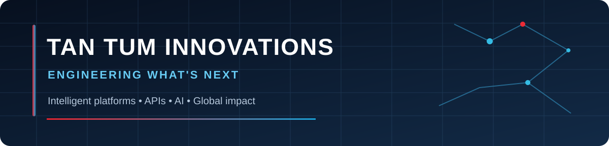

 

### Don Demont | Founder & Software Engineer

**Tan Tum Innovations, LLC** · Software Platforms · AI Systems · Developer Infrastructure · Intelligent Services

*Engineering what's next. Improving the plight of humanity.*

[**Company Website**](https://tantum101.com) &nbsp;·&nbsp; [**GitHub Portfolio**](https://github.com/tantum101?tab=repositories) &nbsp;·&nbsp; [**Business Inquiries**](https://tantum101.com)

---

## Building technology with purpose

I'm Don Demont, founder of **Tan Tum Innovations, LLC**. We're developing a connected portfolio of software products and technology initiatives designed to make complex systems simpler, businesses more capable, and digital services more accessible.

Our focus is on the intersection of **AI, APIs, cloud engineering, data intelligence, automation, connected services, and immersive computing**. We build with a long-term vision of interoperable platforms that can grow across sectors and geographies.

> **Our approach:** Build the foundations responsibly. Demonstrate meaningful capabilities. Protect the systems that differentiate our products.

## The Tan Tum innovation ecosystem

**16 product initiatives. One commitment to practical, human-centered innovation.** The names below represent our product portfolio, not a claim that every product is publicly launched or generally available.

| Product | Focus | Product vision |
| :--- | :--- | :--- |
| **Builder Studio Pro™** | Application platform | Engineering tools for building and operating modern applications. |
| **BeyondApps Plus™** | Modular app builder | Composable applications and reusable business functionality. |
| **B.E.E.P™** | Entrepreneur education | Digital learning and resources for entrepreneurs. |
| **Xotic Ambitionz™** | Talent & brand management | Tools for creators, talent operations, and brand relationships. |
| **StarGaze™** | AR / VR entertainment | Immersive digital experiences and interactive environments. |
| **Marble Wars™** | Interactive gaming | Game experiences built around engaging interactive worlds. |
| **Moving Art Innovations™** | Creative production | Digital creativity and production workflows. |
| **Retail Genius™** | Retail intelligence | Operational analytics and decision-support capabilities. |
| **Manifestor’s OS™** | Personal growth | A digital environment for planning and intentional action. |
| **Gratitude OS™** | Personal development | Reflective practices and personal-development tools. |
| **Zip2Delivery™** | Logistics & fleet | Delivery coordination, courier workflows, and dispatch. |
| **Books 2 Go™** | Financial operations | Virtual bookkeeping and business finance workflows. |
| **Elivion Health™** | Telehealth & wellness | Connected health and wellness service experiences. |
| **GoDijo™** | On-demand food delivery | Digital food-ordering and delivery coordination. |
| **Clockwork Mechanics™** | Automotive services | Vehicle service coordination and dispatch experiences. |
| **Flexwell API™** | Developer infrastructure | An API-first foundation for integrations and intelligent agents. |

**Featured engineering priorities**

<table>
<tr><td width="33%" valign="top"><strong>Flexwell API™</strong> API-first infrastructure, integrations, orchestration, and agent-aware services.</td><td width="33%" valign="top"><strong>Builder Studio Pro™</strong> Reusable software foundations and accelerated application development.</td><td width="33%" valign="top"><strong>Retail Genius™</strong> Business intelligence and actionable operational insights.</td></tr>
</table>

## How we engineer

- **Interoperability by design:** Well-defined interfaces and composable services.
- **Data with purpose:** Reliable foundations for reporting, analytics, and intelligent workflows.
- **Security as an engineering practice:** Least privilege, thoughtful data boundaries, and controlled disclosure.
- **Human-centered delivery:** Products that solve identifiable problems rather than chase novelty.
- **Scalable foundations:** Architecture designed to evolve through iteration and validation.

**Technology areas:** TypeScript · JavaScript · Node.js · React · PostgreSQL · REST APIs · Cloud Infrastructure · AI Agents · MCP · Data Analytics · IoT · AR/VR

## Public innovation. Private implementation.

This GitHub profile is a **curated innovation showcase**, not an open-source release of our proprietary applications.

| We may publish | We keep private |
| :--- | :--- |
| Product descriptions and approved screenshots | Production application code and internal packages |
| Select demonstrations and public-facing prototypes | Private API implementations and database schemas |
| High-level engineering insights | Agent prompts, system credentials, secrets, and infrastructure configuration |
| Verified milestones and launch announcements | Customer information, unreleased roadmaps, and confidential business materials |
| Explicitly licensed examples, when available | Proprietary algorithms and commercially sensitive research |

**Important:** Publicly visible content is not an invitation to reuse our proprietary technology. Any separately published source-code repository will state its own license and permissions. Please do not assume that a product description, screenshot, or public repository grants rights to private software, trademarks, or other protected assets.

We do **not** publish production secrets, access tokens, proprietary datasets, or customer records.

## Research and engineering activity

Much of our development takes place in private repositories. Where enabled by GitHub settings, the public contribution graph may display **anonymized private contribution activity** without revealing private repository names or contents.

Our public updates will emphasize **demonstrated capabilities and verified milestones** rather than unsubstantiated launch claims.

## Work with Tan Tum Innovations

We are interested in meaningful conversations about custom software engineering, API integration, business process automation, analytics, and potential product partnerships.

**Start here:** [tantum101.com](https://tantum101.com)

> **For visitors:** The presence of a product on this page indicates a portfolio initiative, not a promise of public availability. Product details and demonstrations are shared selectively as they become ready.

---

**TAN TUM INNOVATIONS, LLC**

*Innovating to improve the plight of humanity.*

© 2026 Tan Tum Innovations, LLC. Product names and marks identify their respective initiatives. All rights reserved where applicable.

